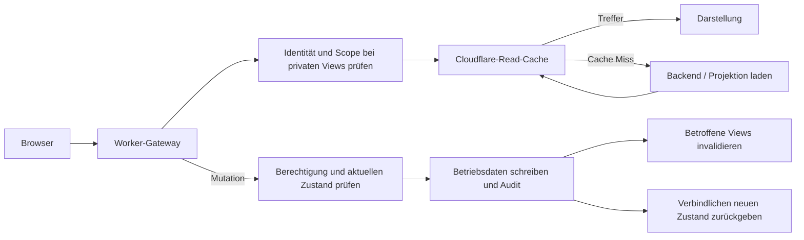

# Eventredaktion, Übersetzungen, RBAC und Cloudflare-Auslieferung

Stand: 18.10.2026. **Architekturvorschlag mit verbindlichen Nutzervorgaben**,
keine aktivierte Cloudflare-Migration und keine Änderung an Produktion oder
Eventdaten. Neu festgehalten: operative Aktionen ohne GitHub-Schritt;
Cloudflare als Cache-Gateway für Darstellungsdaten, gezielte Invalidierung
bei Änderungen und ungefähr eine Stunde TTL als Standard für unkritische Views.

## Implementierter Zwischenstand am 18.10.2026

Das [gemeinsame Eventmodell](shared-event-model.md) ist inzwischen umgesetzt:
97 redaktionelle Sprachschlüssel liegen nun beim Event; Karten und Detailtexte
verwenden gemeinsame Bindungen. Website und Editor teilen den Kartenrenderer.
Astro bettet den öffentlichen Katalog statisch ein; der redundante zweite
Event-API-Aufruf ist aus dem Browser-Ladeweg entfernt. Die API bleibt als
kompatibler Leser erhalten. Betriebsdaten, RBAC und Cloudflare-Hosting sind
weiterhin nicht migriert. Die folgende Bestandsaufnahme dokumentiert den
Ausgangspunkt dieses Umbaus.

## Befund vor dem Eventmodell-Umbau

| Bereich | Aktuelle Quelle / Verhalten |
| --- | --- |
| Öffentlicher Eventkatalog | `data/events.json`, einschließlich DE/EN, Status, Gruppe, Bild und beworbener Kapazität |
| Öffentliche API | `api/events.js` liest dieselbe Repository-Datei; kein Sheets-/Datenbankabruf für Eventtexte. Header: `s-maxage=60, stale-while-revalidate=300` |
| Browserabrufe | `script.js:loadEvents()` lädt erst `data/events.json`, danach `/api/events`; API-Ergebnis wird bevorzugt. Zwei Abrufe für weitgehend dieselben Inhalte, potenziell aus verschiedenen Deployments |
| Eventdetailseiten | HTML-Fragmente unter `src/content/pages`, eigene Eventtexte und DE/EN-Schlüssel in `i18n.js`. Kein durchgängiges gemeinsames Eventmodell |
| Anmeldung | `api/register.js`: Firebase-Identität, Profilprüfung und private Sheets-Daten; Einladungen/Mail. Event-IDs, Labels, Datumswerte und bestimmte Rollenregeln sind teilweise im Code fest verdrahtet |
| Persönlicher Bereich / Orga | `member`, `summary`, `admin`, `registration-action` arbeiten mit privaten Sheets-Daten; Adminprüfung über serverseitige E-Mail-Allowlist. Kein redaktionelles Rollenmodell |
| Lokaler Editor | Eigene vereinfachte Eventdarstellung, lokale JSON-Lese-/Schreibroute, getrennte DE/EN-Dialoge. Kein vollwertiger Eventeditor; keine produktive RBAC-Anbindung |

Die Editorvorschau führt die Website-Skripte absichtlich nicht aus. Sie baut
Eventkarten separat nach und ist daher weder visuell noch redaktionell mit der
Website gleichwertig. Eine Workers-Migration behebt diese Trennung nicht von
selbst. Auch die Änderung eines Eventtitels im Katalog aktualisiert heute nicht
zuverlässig Detailseite, E-Mail-Label und deren Übersetzungen.

Im betrachteten Anwendungscode der privaten Endpunkte fehlt ein expliziter
`Cache-Control: private, no-store`-Header. Das belegt keine aktuelle öffentliche
Cache-Auslieferung; die Migrationskonfiguration muss diese Trennung ausdrücklich
absichern. Keine pauschale Cache-Regel für alle API-Routen.

## Empfehlung: getrennte Bearbeitung, gemeinsame veröffentlichte Revision

**Datenbank oder statische Dateien sind keine ausschließenden Alternativen.**
Eine Datenbank kann Entwürfe, Rechte und Freigaben speichern, während Besucher
ausschließlich einen freigegebenen statischen Stand erhalten.

Für die gegenwärtige Projektphase reicht Git als redaktionelle Quelle. Eine
zusätzliche Inhaltsdatenbank ist erst gerechtfertigt, wenn die Redaktion online,
ohne lokalen Checkout, mit mehreren Bearbeitern und serverseitigen Freigaben
arbeiten soll. Das Datenformat und der Renderer sollen beide Speicheradapter
unterstützen; nicht vorsorglich zwei schreibbare Wahrheiten einführen.

```mermaid
flowchart LR
  E[Eventeditor DE / EN] --> D[Entwurf und Revision]
  D --> R[Rechteprüfung und Freigabe]
  R --> B[Veröffentlichung einer geprüften Revision]
  B --> H[Statische Eventseiten und öffentlicher Katalog]
  H --> C[Cloudflare Static Assets / Cache]
  C --> V[Besucher]
  V -->|nur persönliche Aktionen| W[Worker: Identität und Geschäftsregeln]
  W --> P[Private Anmeldungen und Profile]
```

Der Renderer verwendet im Editor den Entwurf und im Build den veröffentlichten
Stand. Ein gemeinsamer Renderer für Karten und Detaildaten verhindert weitere
Abweichungen. Website-Laufzeitskripte einschließlich Login, Mail oder Anmeldung
sollen nicht einfach im Editor aktiviert werden.

## Ein Eventmodell mit klaren Zuständigkeiten

### Redaktionelle, öffentliche Inhalte

- Stabile Event-ID, Slugs/Routen, Bildreferenzen, Format und explizite Archivgruppe.
- Sprachneutrale Fakten: Start/Ende als Zeitwerte mit Zeitzone, Veranstaltungsort,
  strukturierte Kosteninformationen, sofern fachlich bereits geklärt.
- Übersetzbare Felder pro Sprache: Titel, Kurztext, Beschreibung, Anfahrt,
  organisatorische Hinweise, Bildalternativtexte und Metadaten.
- Revision, Entwurfsstatus, Freigaben und Veröffentlichungsstand gehören zum
  redaktionellen Verwaltungsmodell; nicht zum unkontrollierten öffentlichen Export.
- Ein allowlist-basierter Export erzeugt nur freigegebene öffentliche Felder.
  Unbekannte/private Felder dürfen nicht automatisch ins Build-JSON gelangen.

### Operative Daten und verbindliche Regeln

- Registrierungsöffnung/-schluss, tatsächlich geltende Teilnehmerlimits,
  Rollenmix, Zahlungs-/Einladungsstatus und gegebenenfalls Reservierungen.
- Namen, E-Mail-Adressen, Profile, Einwilligungen und interne Orga-Notizen.
- Stabile Event-ID verbindet beide Bereiche; Übersetzer können diese ID und
  operative Regeln nicht ändern.
- Beworbene Gesamtkapazität ist kein Live-Restplatzbestand. Öffentliche Texte
  ersetzen nie die Prüfung beim Schreiben einer Anmeldung.
- Beim Anmelden prüft der Server Eventexistenz, aktuellen Anmeldestatus,
  Berechtigung und Geschäftsregeln anhand einer autoritativen Revision.
  Kritische zwischenzeitliche Änderungen verlangen eine erneute Bestätigung.

Heute wird ein nicht leerer Eventschlüssel in `validate()` akzeptiert; zusätzliche
Sonderregeln sind an bestimmte IDs gebunden. Der spätere gemeinsame Event-/Policy-
Lookup muss diese fest verdrahteten Sonderfälle ersetzen und unbekannte oder
geschlossene Events serverseitig zurückweisen. Dies ist hier noch nicht umgebaut.

## Übersetzungsablauf

1. Ein Event wird in einer gewählten Quellsprache als Entwurf angelegt.
2. Jedes übersetzbare Feld hat eine Quellrevision beziehungsweise einen
   Quelltext-Hash. Ein Zieltext merkt sich den Stand, auf dem er basiert.
3. Die Redaktion unterscheidet `fehlt`, `Entwurf`, `zu prüfen`, `freigegeben`
   und `veraltet`. Leerer Zieltext und veraltete Übersetzung sind unterschiedliche
   Fälle; die aktuelle Editorlogik erkennt bislang nur fehlende Texte.
4. Beim Bearbeiten einer Sprache erscheint ein Fallback in der anderen Sprache
   mit Kennzeichnung. Er wird nicht automatisch als Zielübersetzung gespeichert.
5. Änderungen der Quelle markieren betroffene Übersetzungen als veraltet.
   Gemeinsame Fakten wie Datum und numerischer Preis werden einmal geändert;
   formatierte Datumsangaben entstehen pro Sprache daraus.
6. Veröffentlichung verwendet explizit freigegebene Sprachstände. Für fehlende
   optionale Übersetzungen ist eine dokumentierte Fallback-Freigabe möglich;
   Pflichtfelder oder fachlich kritische Änderungen blockieren die Freigabe.
7. Liste, Detailseite und öffentliche Daten erhalten dieselbe Inhaltsrevision.
   Nicht aus voneinander unabhängigen JSON-/HTML-/i18n-Ständen zusammensetzen.

Empfehlung für DE/EN bei kleinen Datenmengen: beide Sprachfassungen zusammen
ausliefern. Sprachwechsel erzeugt dann keine zusätzliche Backend-Anfrage.

## Vorgeschlagenes redaktionelles RBAC

Rollen sind kombinierbar und event-/sprachbezogen einschränkbar. Die Namen sind
ein Vorschlag, keine bereits implementierten Rechte.

| Rolle | Befugnis | Grenze |
| --- | --- | --- |
| Autor / Redaktion | Zugewiesene Events und öffentliche Quellinhalte als Entwurf ändern | Kein Zugriff auf Teilnehmerdaten, keine Veröffentlichung |
| Übersetzer | Zugewiesene Zielsprachen bearbeiten und zur Prüfung vorlegen | Keine Event-IDs, Preise, Regeln, Rollen oder Quellfakten ändern |
| Prüfer / Herausgeber | Exakte Inhaltsrevision samt Sprachständen prüfen und veröffentlichen | Keine automatische Berechtigung für private Anmeldungen |
| Eventorganisation | Operative Regeln und zugewiesene Anmeldungen verwalten | Kein allgemeiner redaktioneller oder technischer Adminzugang |
| Zugriffsadministrator | Rollen und Zuweisungen verwalten | Veröffentlichung und Teilnehmerzugriff nur mit gesonderter Berechtigung |

Serverseitig erforderlich: verifizierte Identität, Event-/Sprachscope,
Feld-Allowlist, Vergleich der erwarteten Basisrevision, Auditspur sowie erneute
Autorisierung beim Veröffentlichen. Eine Freigabe gilt für eine bestimmte Revision;
weitere Änderungen invalidieren sie. Rechte dürfen nicht aus frei bearbeitbarem
Inhalt, einem Browserfeld oder einem Cache-Eintrag stammen.

Git-Variante: Änderungen als Entwurf/PR; ein vertrauenswürdiger serverseitiger
Prüfschritt bewertet Felder, Sprachen und freigegebene Revision. Git-Schreibrechte
allein bilden diese fachlichen Rechte nicht ab. Übersetzer dürfen keine CI-/Code-
Änderungen einschleusen können. Aktuelle lokale Editorsitzungen bleiben lokal und
werden nicht ohne zusätzliche Absicherung als Online-CMS exponiert.

## Auslieferung und Cachegrenzen auf Cloudflare

| Daten / Anfrage | Vorgeschlagenes Verhalten |
| --- | --- |
| Öffentliche Eventseiten, Bilder und Katalog | Statisch über Workers Static Assets; keine Sheets-/D1-Abfrage pro Besucher |
| Katalog ohne zusätzliche Browseranfrage | Im HTML eingebettet / beim Build gerendert; bevorzugt für die Startseite |
| Separater Katalog bei Bedarf | Dateiname mit Inhaltshash; `public, max-age=31536000, immutable` nur für unveränderliche, öffentliche Dateien |
| HTML / Versionsverweis | Revalidierung beziehungsweise kurze Lebensdauer; neue Publikation verweist auf neue Hash-Datei. Keine Jahres-TTL für stabile, überschreibbare URLs |
| Redaktionelle Entwürfe und persönliche Verwaltungsansichten | Authentifiziert; Browserantwort `private, no-store`; interne Cloudflare-Read-Caches nach geprüfter Identität und Scope möglich, keine Veröffentlichung durch Build oder statischen Fallback |
| Mitglieds-/Anmeldeansichten | Interner Cache nur hinter erneuter Autorisierung, mit isoliertem Event-/Benutzer-/Berechtigungsscope; keine öffentlichen Cache-Einträge |
| Rollen, Zugriffsentscheidungen und Aktionstoken | Keine pauschale Stunden-TTL; Autorisierung und Tokenprüfung unabhängig vom Darstellungs-Cache |
| Öffentliche aggregierte Statusansicht | Explizit öffentliche Felder, Standard-TTL etwa 1 h plus Invalidierung bei Änderungen; konkrete Echtzeit-Anforderung kann kürzere TTL rechtfertigen. Kein Teilnehmerbezug, kein dauerhaftes Polling |
| Anmeldeschreiben | Immer autoritative Geschäftsprüfung; kein Vertrauen auf eventuell veraltete öffentliche Statusdaten |

Static Assets werden standardmäßig vor Worker-Code aufgelöst. Worker-Ausführung
gezielt auf private und API-Pfade begrenzen; ein globales `run_worker_first: true`
ist für die öffentlichen Eventseiten nicht erforderlich. Private Pfade dürfen
aber nie durch eine versehentlich vorhandene statische Datei oder einen SPA-
Fallback an der Autorisierung vorbeilaufen.

Statische Veröffentlichung: ein vollständiger Build enthält Katalog und Seiten
derselben Revision. Alte Hash-Assets bleiben nur solange erreichbar, wie alte
HTML-/Browserstände darauf angewiesen sind; die Aufbewahrungsstrategie muss beim
konkreten Deployment geprüft werden. Ein späterer Datenbank-/R2-Publisher muss
zuerst alle Artefakte schreiben und erst danach den Versionsverweis umschalten.

Änderungen nur im Entwurf lösen keine öffentliche Cache-Invalidierung aus.
Veröffentlichungen dürfen gebündelt werden. Betriebsdaten wie kurzfristige
Anmeldeschließung müssen ohne Website-Rebuild sofort serverseitig wirksam sein.

Eine zusätzliche Workers-Cache-Schicht ist für bereits statisch ausgelieferte
Kataloge unnötig. Falls später ein dynamischer öffentlicher Endpunkt notwendig
wird, zuerst aktuelle Workers-Cache-Möglichkeiten prüfen. Die klassische Cache API
ist kein global replizierter, autoritativer Speicher und darf keine RBAC- oder
Teilnehmerwahrheit tragen.

## Ergänzte Nutzervorgabe: operative Aktionen ohne GitHub

Teilnehmer akzeptieren/ablehnen, Einladungen bestätigen, Zahlungen markieren,
Anmeldungen schließen oder andere operative Statuswechsel sind direkte,
serverseitig autorisierte API-Aktionen. **Kein Commit, Check-in, Pull Request,
GitHub-Check, Website-Build oder Deployment ist dafür erforderlich.** Git bleibt
allenfalls ein Werkzeug für redaktionelle Veröffentlichung und Codeänderungen.

Operative Wahrheit liegt in der Betriebsdatenquelle: aktuell Sheets, bei einer
späteren eigenständigen Migration gegebenenfalls D1. Eine erfolgreiche Aktion
schreibt diese Quelle, erzeugt eine Auditinformation und stößt die Invalidierung
abhängiger Darstellungsdaten an. Verbindliche Prüfungen wie Berechtigung,
Teilnehmerlimit und zulässiger Zustandswechsel verwenden nicht die gecachte View.

## Cloudflare-Gateway: Lesen cachen, Schreiben autoritativ ausführen

Der Standardpfad für Daten, die zur Darstellung gebraucht werden, ist:

Öffentliche statische Dateien können weiterhin direkt aus Static Assets kommen.
Für dynamisch erzeugte öffentliche oder geschützte Darstellungsdaten übernimmt
der Worker die Cache-Grenze. Ein Cache-Treffer soll weder Sheets-/D1-Abfragen
noch wiederholte teure Aggregationen für die Darstellung auslösen. Der notwendige
Gateway-/Autorisierungsschritt für private Views bleibt bestehen.

### TTL und Browsercache getrennt behandeln

- **Standard für unkritische Darstellungsdaten: 3.600 Sekunden am Cloudflare-
  Cache**, ergänzt um aktive Invalidierung. Konkrete fachliche Ausnahmen werden
  pro View dokumentiert; nicht pauschal alles auf Echtzeit oder auf eine Stunde
  setzen.
- Öffentliche API-Views können beispielsweise am Browser eine kurze Lebensdauer
  oder Revalidierung und am Edge eine Stunde haben. Eine Stunde Browser-`max-age`
  wäre durch Cloudflare-Purge nicht zuverlässig widerrufbar und ist deshalb
  nicht der Standard für veränderliche Daten.
- Persönliche Antworten bleiben nach außen `private, no-store`. Der Worker kann
  intern dennoch eine autorisierte Darstellung wiederverwenden. Browserheader
  und interne Cachebarkeit sind unterschiedliche Verträge.
- Unveränderliche, versionierte Medien und Veröffentlichungsartefakte dürfen
  weiterhin deutlich länger gespeichert werden.
- Eine Stunde ist für Darstellungsfrische akzeptabel, nicht für die verbindliche
  Annahme eines Teilnehmers, Sperrung eines Zugangs oder Prüfung eines Aktionslinks.

### Öffentliche und geschützte Cache-Einträge

Öffentliche Views enthalten ausschließlich freigegebene öffentliche Felder.
Geschützte Views dürfen nur über einen nicht gecachten Gateway-Einstieg erreicht
werden, der **jeden Abruf** authentifiziert und autorisiert. Erst danach kann ein
interner gecachter Entry-Point mit normalisiertem, vertrauenswürdigem Scope lesen.
Dieser Entry-Point darf nicht zusätzlich als ungeschützte öffentliche Route
erreichbar sein. Autorisierungsheader werden erst nach dieser Prüfung aus einer
internen Anfrage entfernt; niemals global oder vor der Prüfung.

Cache-Schlüssel enthalten die erforderlichen Dimensionen: Event, Ansicht,
Sprache, Inhalts-/Schemarevision und bei privaten Daten Benutzer oder eine
nachweislich identische Berechtigungsgruppe. Gleicher Rollenname allein genügt
nicht: zwei Organisatoren können unterschiedliche Eventzuweisungen haben.
Zugriffsentscheidungen müssen nach einem Rollenentzug sofort neu bewertet werden;
ein alter gecachter Antwortkörper darf keinen Zugang erhalten. Rollen-/Policy-
Caching benötigt dafür einen separaten Vertrag, keine pauschale Stunden-TTL.

### Abhängigkeiten und aktive Invalidierung

| Auslöser | Abhängige Views, die invalidiert werden |
| --- | --- |
| Teilnehmer akzeptiert/abgelehnt | Orga-Teilnehmerliste des Events, persönliche Anmeldeansicht, Eventzusammenfassung und gegebenenfalls öffentlicher aggregierter Status |
| Zahlung oder Einladung geändert | Betroffene Anmeldung, persönliche/Orga-Statusansichten, relevante Zusammenfassungen |
| Registrierung geöffnet/geschlossen | Öffentlicher Anmeldestatus, Orga-Eventansicht; Schreibprüfung gilt sofort unabhängig vom Cache |
| Redaktionelle Revision veröffentlicht | Eventdetail, Katalog/Listen und betroffene Sprach-/Metadatenansichten beziehungsweise neue Artefaktversion |
| Entwurf geändert | Nur zugehörige geschützte Vorschau-/Redaktionsansichten; kein öffentlicher Cache-Purge |
| Berechtigung geändert | Betroffene geschützte Views und gegebenenfalls separate Berechtigungs-Caches; Gateway prüft weiterhin den aktuellen Zugriff |

Tags oder vergleichbare Abhängigkeitsschlüssel beschreiben Event, Registrierung
und Viewklasse, nicht rohe Tokens oder E-Mail-Adressen. Kein globaler Purge nach
jeder Teilnehmeraktion. Der schreibende Handler delegiert Invalidierungen an den
Entry-Point, der die betroffenen Einträge tatsächlich besitzt.

Für sichtbare Zustandswechsel bevorzugt den betroffenen Eintrag **entfernen**
statt nur als stale markieren. Weiches Invalidieren/Revalidieren und
`stale-while-revalidate` bleiben Möglichkeiten für unkritische Inhalte mit
ausdrücklich erlaubter veralteter Anzeige.

Invalidierung erst nach erfolgreichem Schreiben, mit wiederholbarem Auftrag bei
Fehlern. Fehlgeschlagener Purge darf nicht die bereits ausgeführte Aktion
verschweigen oder einen erneuten nicht-idempotenten Schreibversuch verursachen.
Die API liefert den verbindlichen neuen Zustand direkt zurück; die handelnde
Oberfläche muss ihn nicht sofort aus einer eventuell noch alten View nachladen.
TTL bleibt das Auffangnetz. Kritische Zustände und Rechte dürfen sich nicht
allein auf die erfolgreiche weltweite Cache-Invalidierung verlassen.

Für Cache-Refills, die während eines Schreibens laufen, ist beim Implementieren
eine Revisions-/Generationsstrategie zu prüfen, damit alte Backendantworten nicht
nach einem Purge erneut als aktueller Stand gespeichert werden. Externe
Änderungen direkt in Sheets werden ohne Webhook/Import nicht automatisch erkannt;
hier greift die vereinbarte TTL oder ein explizites Synchronisationssignal.

### Cloudflare-Mechanik bei Umsetzung prüfen

Die aktuellen Workers-Cache-Beispiele unterstützen einen nicht gecachten
Authentifizierungs-Gateway vor gecachten inneren Entry-Points. Purge und weiche
Invalidierung sind auf den jeweils besitzenden Worker/Entry-Point begrenzt.
Ein normaler Zone-Purge ersetzt diese Invalidierung nicht. Deshalb Cachebesitzer,
Tags und Invalidierungsaufruf gemeinsam entwerfen und in der späteren
Projektkonfiguration prüfen; derzeit ist keine solche Infrastruktur eingerichtet.

## Speicherentscheidung und Reihenfolge

- **Empfohlen jetzt:** Git für Evententwürfe und Freigaben; Astro erzeugt die
  öffentliche Veröffentlichung. Die heutige zusätzliche Katalog-API wird erst
  nach Kompatibilitätsprüfung aus dem öffentlichen Ladeweg genommen.
- **Considered:** D1 für redaktionelle Entwürfe, Sprachrevisionen, Zuweisungen
  und Audit, wenn ein gehosteter Mehrbenutzereditor benötigt wird. Veröffentlichung
  bleibt statisch. D1 ist nicht Voraussetzung für das Beheben der Editoransicht.
- **Considered:** D1 als späterer Ersatz für operative Sheets-Daten nach eigenem
  Migrationsplan. Diese Entscheidung nicht mit der Eventtextredaktion vermischen.
- **Considered:** R2 für redaktionell hochgeladene Medien oder Veröffentlichungs-
  artefakte, wenn unabhängig vom Build veröffentlicht werden muss. Derzeit reichen
  vorhandene statische Assets; kein neuer R2-/KV-/Queue-Dienst ohne konkreten Bedarf.
- **Rejected als Zielmodell:** Jeder Besucher lädt Eventtexte aus Sheets/D1;
  öffentliche Seiten und private Anmeldedaten werden zusammen gecacht;
  lokale JSON und eine Datenbank sind gleichzeitig gleichberechtigt schreibbar.

Nächste Umsetzung: (1) gemeinsames Eventmodell und Adapter; (2) gemeinsamer Karten-
und Detailrenderer mit Vorschau; (3) Event- und Übersetzungsentwürfe im Editor;
(4) geprüftes Veröffentlichungsartefakt; (5) Rollen-/Revisionsprüfung;
(6) Cloudflare-Hosting und getrennte operative Backendmigration.
Keine automatische Änderung vorhandener Eventgruppen, Preise oder Anmeldefakten.

## Abnahmekriterien

- Alle vorhandenen Events erscheinen im Editor mit derselben Gestaltung wie
  öffentlich; fehlende DE/EN-Texte und lokale Entwurfsänderungen sind erkennbar.
- Ein Entwurf verändert die öffentliche Website nicht; Veröffentlichung nimmt
  nur die geprüfte Event-/Sprachrevision auf. Zurücksetzen ist nachvollziehbar.
- Ein anonymer Startseitenaufruf löst keine dynamische Event-/Sheets-/D1-Anfrage
  aus. Sprachwechsel erzeugt ebenfalls keine solche Anfrage.
- Übersetzer können im API-Test keine operative Regel und keinen fremden
  Sprachbereich ändern; Herausgeber können keine ungeprüfte Revision publizieren.
- Private Antworten und Aktionslinks sind niemals öffentlich cachebar.
- Teilnehmer akzeptieren/ablehnen funktioniert ohne GitHub und ohne Deployment.
- Cache-Treffer einer Darstellungs-View vermeiden den entsprechenden Backend-Read;
  Standard-Edge-TTL beträgt ungefähr eine Stunde. Eine erfolgreiche Mutation
  invalidiert die betroffenen Views und liefert direkt den verbindlichen Zustand.
- Geschützte Cache-Treffer können Autorisierung oder Event-/Benutzergrenzen nicht
  umgehen. Rollenentzug wird nicht eine Stunde durch gecachte Views verzögert.
- Gleichzeitige Bearbeitung führt zu einem sichtbaren Revisionskonflikt;
  Anmeldung prüft den aktuellen operativen Stand auch bei veralteter öffentlicher
  Darstellung.

## Geprüfte Cloudflare-Referenzen

- [Workers Static Assets: Routing und automatisches Caching](https://developers.cloudflare.com/workers/static-assets/)
- [Static Asset Headers, ETag und `_headers`-Grenzen](https://developers.cloudflare.com/workers/static-assets/headers/)
- [Selektives Worker-first-Routing](https://developers.cloudflare.com/workers/static-assets/routing/worker-script/)
- [Cache API: lokale Cachegrenzen](https://developers.cloudflare.com/workers/runtime-apis/cache/)
- [Workers Cache: Gateway, geschützte Views und Invalidierung bei Writes](https://developers.cloudflare.com/workers/cache/examples/)
- [Workers Cache: Purge, weiche Invalidierung und Entry-Point-Scope](https://developers.cloudflare.com/workers/cache/purge/)

Header aus `_headers` gelten für statische Asset-Antworten; von Worker-Code
erzeugte Antworten benötigen ihre Header im Handler selbst.
